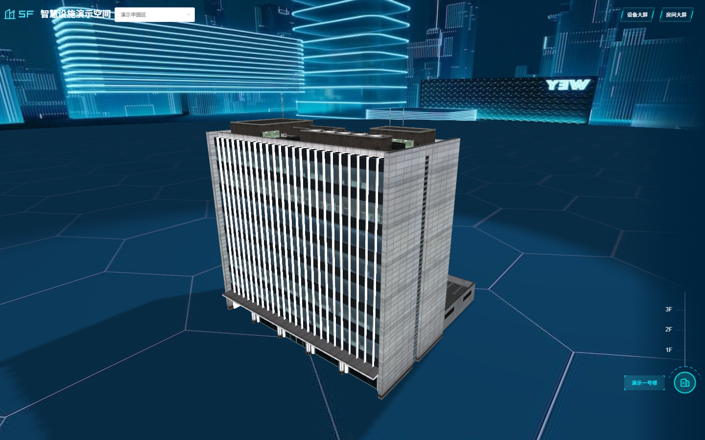
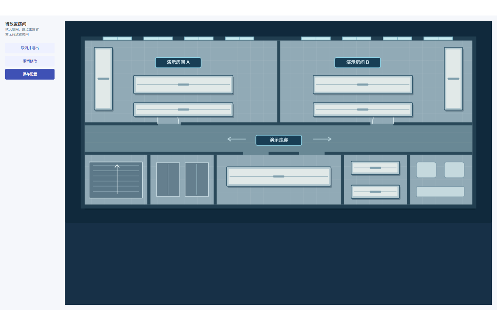
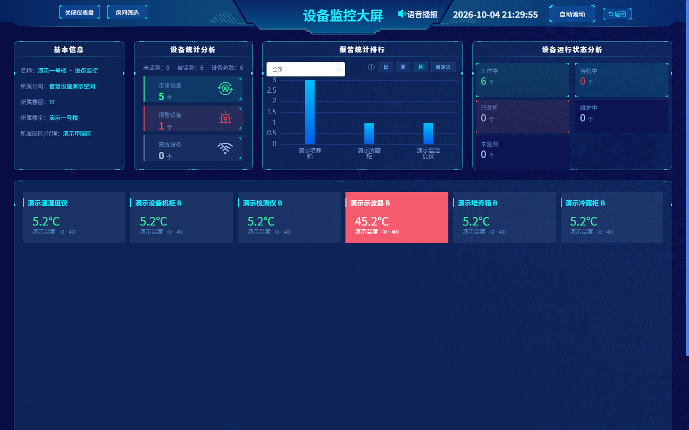
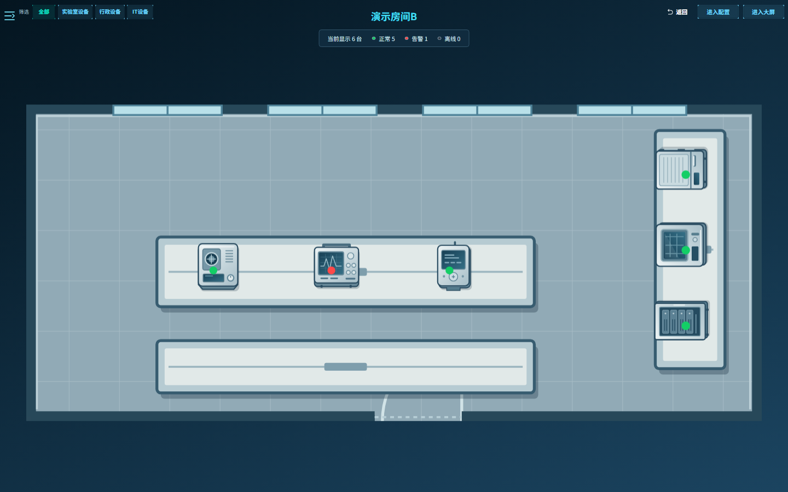
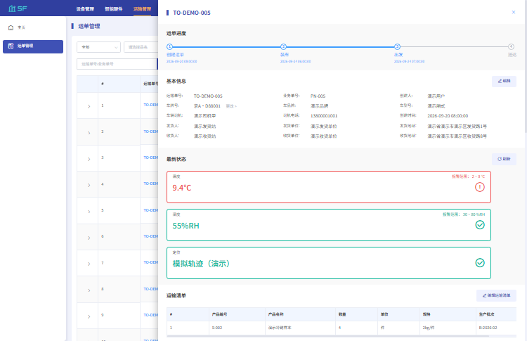

# 智慧设施平台 · Smart Facility

面向实验室设施运营的前端项目，包含 **Three.js 楼宇可视化、楼层与房间地图、监控大屏、SaaS 管理后台和关联微信小程序**。本仓库是用于代码阅读和求职展示的本地演示副本，业务数据由 Mock 提供，无需连接原业务服务器。

## 给面试官

建议先阅读下面的项目背景，再按「推荐体验路线」体验核心功能；「代码阅读入口」可以直接定位实现，「设计与面试讨论」说明主要业务规则。无需逐个查看所有管理页面。

[面试阅读导览](docs/PROJECT_GUIDE.md)将本人职责、Three.js 生命周期、Konva 坐标与预约统计组织为一条阅读路线。原工作项目为楚秀项目，当前名称为脱敏作品名。

**沟通方式：**我是一名听障人，面试中希望以文字提问与回答。请尽量一次写完整问题，涉及代码时注明文件或功能入口；我可以结合代码说明实现、边界和取舍。本 README 提前介绍项目，减少现场反复确认背景的时间。

## 项目背景与我的角色

我入职时，前端采用 Vue 1 的第一版项目已经开展了一部分开发。我加入后主要承担复杂模块、业务功能及公共组件封装。项目推进至约一半时，工程结构和需求组织已较混乱，团队持续投入较长时间仍难以有效推进。

后来公司更换产品经理并重新梳理需求，同时邀请专业老师选拔重构团队，对整个前端和后端进行重构。我作为**重构组成员及前端主力**参与第二版前端建设，采用当时主流的 Vue 2，根据重新梳理并分配给我的需求文档实现所负责模块。前后端整体重构由团队共同完成，我的个人贡献主要在前端。

### 我负责的核心功能

我主要承担复杂交互及业务功能，明确负责的范围包括：

| 负责范围 | 具体内容 |
| --- | --- |
| 中控地图模块 | Three.js 楼宇可视化与楼层、房间页面联动，中控地图相关交互 |
| 设备管理模块 | 整个设备管理模块，包括其中的预约功能 |
| 房间管理模块中的地图设置 | Konva 地图配置与设备位置、缩放、旋转等交互 |
| 数据统计 | 数据统计相关页面及功能 |
| 公共组件封装 | 封装供其他模块复用的组件 |
| 关联微信小程序 | 从 0 搭建 uni-app 工程，开发首页、预约、数据图表、移液枪等部分模块 |

以上为本人确认的原项目职责；仓库中其他功能的存在不代表全部由我独立开发。面试时可以优先围绕上述模块讨论需求实现、交互设计和组件复用。

原项目开发于 AI 编程工具普及之前，我负责的功能均为手写实现。当前求职展示副本在原工程上使用 AI 辅助脱敏、Mock 化及演示问题修复。**原项目业务开发与当前演示整理是两个阶段**；当前 Mock 数据、规则适配和演示修复应按本阶段成果说明，不直接当作原项目当年的实现。

项目保留当时的 Vue 2 技术栈，便于展示已有工程中的业务实现与维护实践。

## 核心功能

| 模块 | 可以查看或操作的内容 | 值得关注的实现 |
| --- | --- | --- |
| 楼宇与地图 | 3D 楼宇进入楼层、房间；配置房间和设备位置，移除、撤销、保存；上传楼层/房间底图 | Three.js 生命周期、Konva 交互、业务档案与布局分离 |
| 设备监控与大屏 | 设备读数、历史曲线、房间状态聚合、正常/报警/离线筛选、设备与房间大屏 | 同源状态、统计范围与筛选分离、参数状态与运行状态分离 |
| SaaS 设备管理 | 筛选分页、新增编辑、绑定硬件检查、解绑、删除、XLSX 预览导入与导出 | 数据关联约束、导入确认流程、列表与详情一致性 |
| 预约与告警 | 预约日历、新增/修改/取消、预约记录；告警记录与人工处理 | 时间区间冲突、记录持久化、处理状态与设备状态分离 |
| 移液枪与枪架 | 使用中/在架/超时、枪位查看、模拟取还与使用记录 | 申请与模拟确认分开、离线拒绝操作、空枪位不计为实体 |
| 运单 | SaaS 创建、装车、发运、送达；小程序查看、发运和送达 | 状态流转校验、筛选值与实体状态区分 |

小程序还提供设备与房间详情、预约、告警处理、消息与待办。两端采用一致的主要业务标识和规则，当前各自使用本地存储。

## 推荐体验路线（约 5–10 分钟）

1. **楼宇 → 1F → 房间 A / B**：查看地图交互。默认房间 A 正常，房间 B 中的演示示波器 B 报警；点击房间标记可查看详情或进入房间。
2. **楼层或房间 → 进入配置**：拖动标记、移除布局、重新放置并保存。返回预览后查看保存结果，区分布局操作与档案删除。
3. **设备大屏 / 房间大屏**：点击报警统计卡，查看选中样式及下方筛选结果；再次点击同一统计项取消筛选。总览数量保留当前空间范围的统计。
4. **设备管理 → 设备详情 → 预约日历**：创建未来时段预约，查看预约使用记录；尝试重叠时段或修改、取消预约。
5. **系统管理 → 报警记录**：添加人工处理记录。处理后仍可看到异常读数，设备参数报警不会被人工确认清除。
6. **智能硬件 → 移液枪 / 枪架管理**：查看在架、使用中与超时状态，体验在线枪架的模拟取还；离线枪架会拒绝操作。

时间有限时，优先体验第 1–3 项，再从下方代码入口选择一个主题深入阅读。小程序可作为预约、告警及移液枪业务的补充展示。

### 已有演示截图

以下为本地验证时保存的截图，可先了解界面；具体交互以当前源码运行结果为准。

**Three.js 楼宇可视化**



**楼层房间布局配置**



**设备监控大屏**



<details>
<summary>查看房间设备状态与运单详情</summary>

**房间设备状态：正常与报警设备共存**



**运单详情：进度、温湿度与模拟轨迹**



</details>

## 本地运行

### Web 后台、地图与大屏

在仓库根目录执行：

```powershell
cd smart-facility-platform
npm ci
npm run demo
```

已安装依赖时可直接运行 `npm run demo`。默认地址为 `http://127.0.0.1:8088`，以终端输出为准；启动脚本已处理现代 Node 下 Webpack 4 的 OpenSSL 兼容参数。

| 登录项 | 演示值 |
| --- | --- |
| 账号 | `demo` |
| 密码 | `Demo1234` |
| 验证码 | `2468` |

请使用 `demo` 脚本启动本地演示。推荐操作见上方体验路线，详细运行说明见 [演示指南](docs/demo-guide.md)。

### 微信小程序

1. 用 HBuilderX 导入仓库中的 **`miniprogram`** 目录，这是 uni-app Vue 2 源码工程。
2. 在 `manifest.json` 中配置自己有权限使用的微信小程序 AppID。
3. 在微信开发者工具中开启「设置 → 安全设置 → 服务端口」，再从 HBuilderX 运行到微信开发者工具。
4. 手动导入时选择编译目录 **`miniprogram/unpackage/dist/dev/mp-weixin`**，该目录包含生成的 `app.json`。
5. 使用 `demo` / `Demo1234` 登录本地演示。

源码目录不能作为原生微信小程序直接运行。小程序没有根目录 `package.json`，使用 HBuilderX 编译；H5 预览不能替代微信环境验证。更多说明见 [小程序 README](miniprogram/README.md)。

## 技术栈与目录

| 工程 | 主要技术 |
| --- | --- |
| Web | Vue 2、Vue Router、Vuex、Element UI、Vue i18n、Vue CLI 4 / Webpack 4 |
| 可视化与交互 | Three.js、Konva、ECharts、DataV、FullCalendar、ExcelJS |
| 小程序 | uni-app Vue 2、uni-ui、自定义 TabBar、uCharts、微信小程序编译目标 |
| 演示与验证 | 统一 Mock 适配、localStorage / IndexedDB、`uni` 本地存储、Jest、Node 检查脚本 |

```text
smart-facility-original/
├─ README.md                 项目介绍与阅读导航
├─ smart-facility-platform/  Web 后台、3D 楼宇、地图与大屏
│  ├─ src/views/             业务页面
│  ├─ src/components/        共享组件
│  ├─ src/mock/              演示数据、规则及接口适配
│  └─ tests/unit/demo/       演示业务回归测试
├─ miniprogram/              关联 uni-app 小程序
│  └─ utils/demo/            小程序本地演示规则与存储
├─ scripts/                  小程序检查与编译辅助脚本
└─ docs/                     业务契约、复盘和截图证据
```

## 代码阅读入口

以下入口适合围绕一个问题阅读，不必从全部历史页面开始。

| 讨论主题 | 页面 / 实现 | 对照规则或测试 |
| --- | --- | --- |
| 3D 场景加载与释放 | [Building.vue](smart-facility-platform/src/views/building/Building.vue) | 搜索 `disposeObject3D`、`cancelAnimationFrame` |
| 楼层房间拖动与布局 | [DemoFloorDesigner.vue](smart-facility-platform/src/views/floorConfiguar/components/DemoFloorDesigner.vue)、[布局数据](smart-facility-platform/src/mock/fixtures/floorRoomLayout.js) | [地图布局测试](smart-facility-platform/tests/unit/demo/map-m4.spec.js) |
| 房间设备配置 | [Designer.vue](smart-facility-platform/src/views/roomConfiguar/components/Designer.vue) | [地图与布局](docs/map-and-layout.md) |
| 大屏统计与筛选 | [FloorDataV.vue](smart-facility-platform/src/views/datav/FloorDataV.vue)、[dataV.js](smart-facility-platform/src/mock/fixtures/dataV.js) | [大屏回归测试](smart-facility-platform/tests/unit/demo/datav-review.spec.js) |
| 预约冲突与持久化 | [Web 预约数据](smart-facility-platform/src/mock/fixtures/reservation.js)、[小程序预约数据](miniprogram/utils/demo/reservation.js) | [Web 预约测试](smart-facility-platform/tests/unit/demo/reservation.spec.js)、[预约与告警](docs/reservation-and-alarm.md) |
| 移液枪取还规则 | [Web gun.js](smart-facility-platform/src/mock/fixtures/gun.js)、[小程序 gun.js](miniprogram/utils/demo/gun.js) | [移液枪规则](docs/pipette-gun.md) |
| 运单状态流转 | [Web transport.js](smart-facility-platform/src/mock/fixtures/transport.js)、[小程序 transport.js](miniprogram/utils/demo/transport.js) | [运单规则](docs/transport.md) |
| Mock 与业务页面分离 | [Web Mock 入口](smart-facility-platform/src/mock/index.js)、[小程序 Mock 入口](miniprogram/utils/demo/index.js) | Web 按 `handlers / fixtures` 分离接口与数据规则 |

## 设计与面试讨论

功能说明按主题整理：[地图](docs/map-and-layout.md)、[监控与大屏](docs/monitoring-and-dashboard.md)、[设备与房间](docs/device-and-room.md)、[预约与告警](docs/reservation-and-alarm.md)、[小程序](docs/miniapp-business.md)。

**为什么筛选报警后，正常数量仍然保留？**  
总览回答「当前楼层或房间有多少设备」，下方列表回答「这些设备中哪些符合筛选」。状态筛选只缩小展示列表，空间范围变化才改变总览，避免用户误以为正常设备消失了。

**为什么异常设备仍然显示工作中？**  
参数状态与运行状态表达不同含义。温度超限可以发生在设备运行期间；因此参数报警和工作中可以同时存在，分别统计和筛选。

**地图移除与设备删除有什么区别？**  
移除布局只清除地图位置，实体回到待放置列表，档案和业务归属仍保留。删除设备档案涉及关联约束，例如已绑定智能硬件时需要先解绑。

**地图图片与文字为什么分开？**  
底图只包含空间和家具，房间名、设备标记及状态由业务数据动态绘制。改名和状态变化无需重新生成底图；内置 SVG 可作为底图，新上传的 PNG/JPEG 存储在本地 IndexedDB。

**预约怎样判断时间冲突？**  
同一设备使用半开区间 `[start, end)`：两段时间真正重叠才冲突，前一段结束时可以开始下一段。日历与预约记录读取同一预约仓库；小程序还校验当前用户及预约状态。生产环境仍需由服务端校验并发预约。

**处理告警后为什么设备还显示报警？**  
人工处理记录表示已经确认或处置该事件，参数报警表示当前读数仍然越界。处理操作不会伪造读数恢复，消息已读也不会删除告警事件。

**3D 页面退出时如何处理资源？**  
页面退出时取消动画帧，释放控制器、几何体、材质、纹理及渲染器。模型加载回调也需要处理页面已经退出的情况，避免迟到资源继续挂载。

**小程序取枪后，后台是否立即更新？**  
当前演示不会自动同步。两端共享主要业务规则，但使用独立本地 Mock。真实系统需通过共享 API 服务持久化取还记录，并根据枪架反馈更新状态；这里明确区分取枪申请与模拟确认。

## 演示边界与验证

- 数据为合成样例，监测读数和轨迹用于展示；没有真实传感器采集、GPS、枪架反馈或跨端实时同步。
- 短信、电话、微信通知、真实微信登录、蓝牙及真实打印未接入。页面中的本地设置或模拟操作不表示已经发送通知或控制硬件。
- 资产申请审批、完整 BPM / 工单流转等历史目录不作为本次可运行演示功能。
- Web 使用本地存储保存演示操作；小程序通过 `uni` 本地存储保存业务记录。两端演示时钟可能不同，日期以各端界面和业务契约为准。
- 演示模式下未知接口明确失败，不回退原服务；Web 演示配置使用 CSP 限制外部连接。

Web 回归测试在 `smart-facility-platform` 目录执行：

```powershell
npm run test:demo -- --watch=false
```

小程序业务检查在仓库根目录执行，例如：

```powershell
node scripts/check-mp4-demo.cjs
node scripts/check-mp6-demo.cjs
node scripts/check-mp7-transport.cjs
```

单元测试和 Mock 检查用于验证业务规则，不能替代微信模拟器、真机或真实硬件验收。详细规则可通过上方代码表进入对应文档；当前开放范围以本 README 和当前代码为准。
