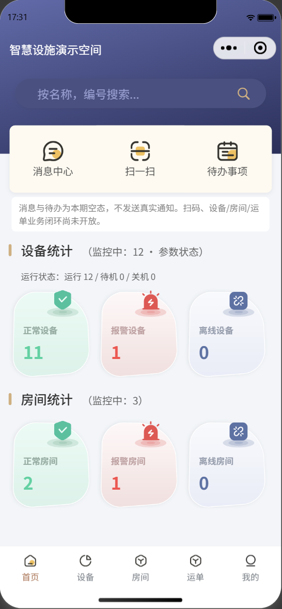
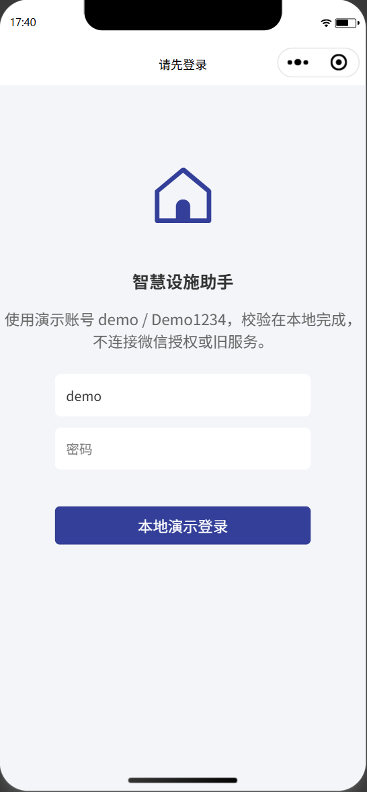
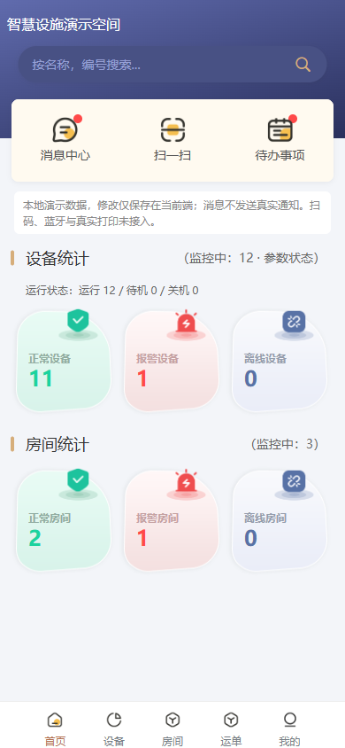
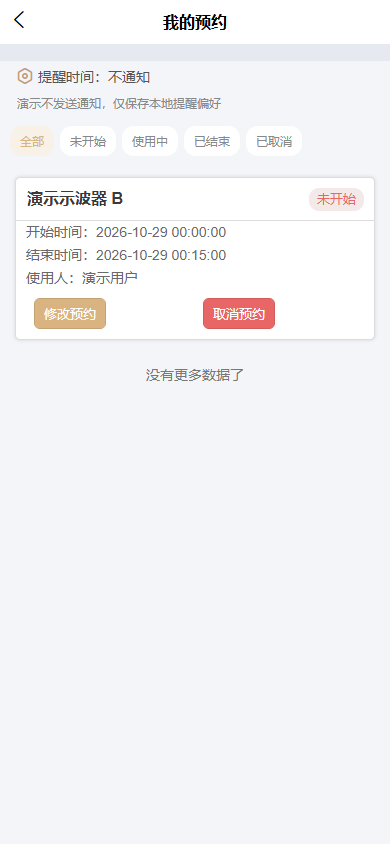

# 智慧设施助手小程序导览

基于 uni-app Vue 2、uni-ui 和 uCharts，展示设备查看、图表、预约与消息处理。本人从 0 搭建原小程序，负责首页、预约、数据图表、移液枪等部分模块，并有部署上线经验；当前脱敏作品通过 AI 协作完成 Mock 整理与 H5 适配。

优先阅读微信小程序业务链路；H5 补充浏览器适配，Android 独立 APK 已在 MuMu Android 15 安装验证核心操作。

## 先看这条链路

**首页 → 设备列表 → 设备详情 → 数据图表 → 预约申请 → 我的预约**

| 步骤 | 看什么 | 对应代码 |
| --- | --- | --- |
| 首页进入设备 | 统计卡筛选、状态与读数 | [首页](../miniprogram/pages/tabBar/Home/Home.vue) → [设备入口](../miniprogram/pages/tabBar/Labdevice/index.vue) → [详情组件](../miniprogram/detailPage/LabdeviceDetail/LabdeviceDetail.vue) |
| 查看历史图表 | 温湿度曲线、时间跨度切换 | [图表页面](../miniprogram/detailPage/HistoryDataChart/HistoryDataChart.vue) |
| 创建并管理预约 | 选时、冲突校验、刷新回填与取消 | [选时组件](../miniprogram/components/AppointmentTime/index.vue) → [预约规则](../miniprogram/utils/demo/reservation.js) → [我的预约](../miniprogram/myPage/MyAppointment/MyAppointment.vue) |
| 按提问补充 | 消息已读、移液枪模拟取还、运单流转 | [消息中心](../miniprogram/homePage/NewsInform/NewsInform.vue) · [移液枪](pipette-gun.md) · [运单](transport.md) |

## 微信小程序

**首页**



**登录**



## 沿链路阅读实现

| 关注点 | 阅读入口 |
| --- | --- |
| 页面与接口分离 | [请求适配](../miniprogram/utils/request.js) → [Mock 入口](../miniprogram/utils/demo/index.js) → [业务规则](../miniprogram/utils/demo/reservation.js) |
| 登录和持久化 | [会话](../miniprogram/utils/demo/session.js) → [存储](../miniprogram/utils/demo/storage.js)，退出清理会话，保留本地业务记录 |
| 返回刷新与跨端组件 | [设备页 onShow](../miniprogram/pages/tabBar/Labdevice/index.vue) → [列表组件](../miniprogram/pages/tabBar/Labdevice/Labdevice.vue)；[导航适配](../miniprogram/components/NavigationBar/index.vue) |
| 移液枪导航 | [详情组件](../miniprogram/detailPage/PipetteGunDetail/GunDetail.vue) → [Mock 规则](../miniprogram/utils/demo/gun.js) → [返回栈处理](../miniprogram/utils/gunNavigation.js) |

## H5 跨端补充

复用小程序业务与 Mock，补充浏览器布局、导航和弹窗适配。

**首页**



**我的预约**



## 安卓扩展

沿用同一 uni-app 工程完成 Android 适配及独立 APK 打包，在 MuMu Android 15 验证登录、导航、设备详情、曲线、预约、报警处理、运单发车和送达，并确认独立冷启动与本地状态保留。初版及修复版的实际覆盖分别列在 [APK 验收记录](android-apk-validation.md)，不将标准基座检查全部算作最终包验收。

安装包不纳入 Git 源码；Android 真机、真实软键盘遮挡仍待验证，首页状态栏颜色仍有限制。iOS 未生成 IPA。

## 本地体验

安装 HBuilderX 及 uni-app Vue 2 编译插件，在仓库根目录执行：

```powershell
cd miniprogram
npm run build:h5
npm run preview:h5
```

打开 `http://127.0.0.1:8188`，账号 `demo` / `Demo1234`。微信小程序通过 HBuilderX 运行到微信开发者工具，步骤见[运行指南](demo-guide.md#微信小程序启动)。

演示使用本地 Mock，各端数据独立；真实微信授权、通知、蓝牙、打印及硬件控制未接入。Android 的模拟器验证不能代替真机或 iOS 验证。

需要深入时再看：[预约与告警](reservation-and-alarm.md) · [验证记录](cross-platform-validation.md) · [检查脚本](../scripts/README.md) · [完整项目导览](PROJECT_GUIDE.md)。
