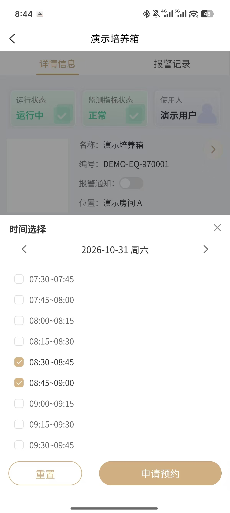
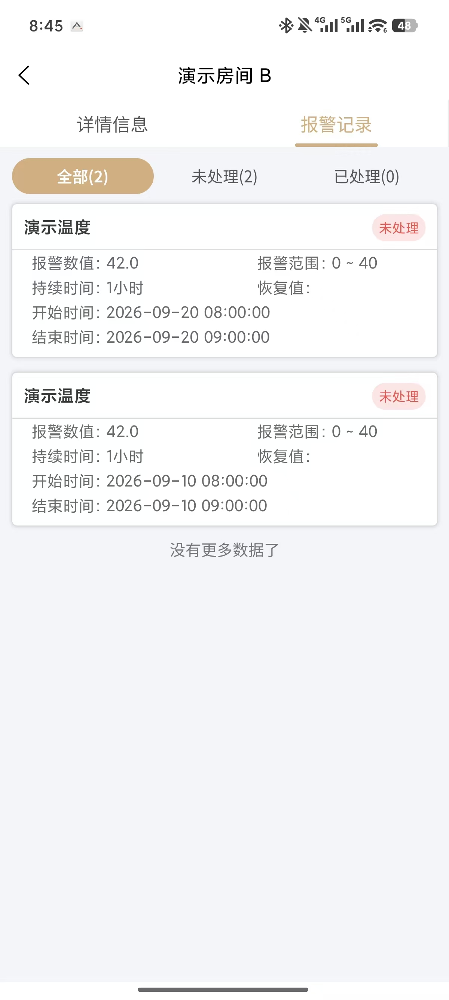
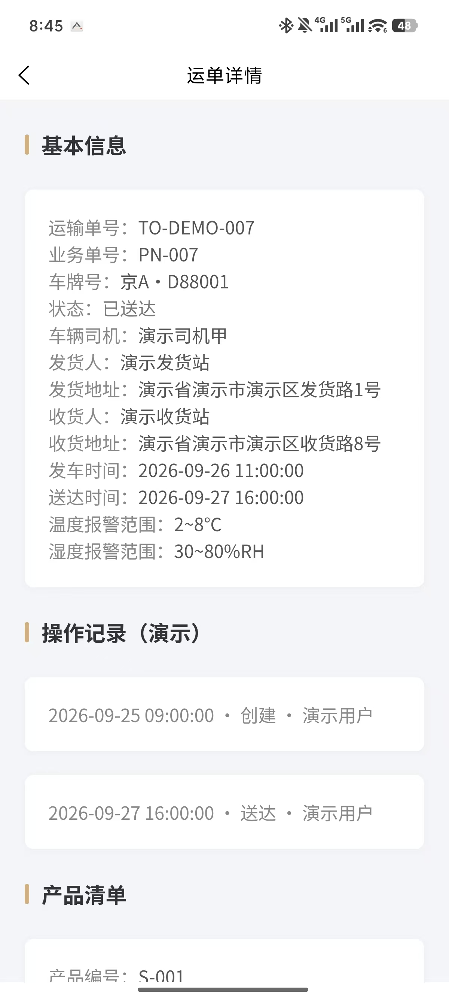
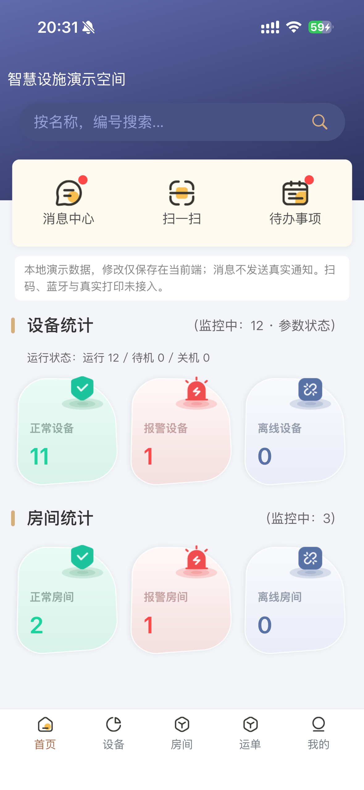
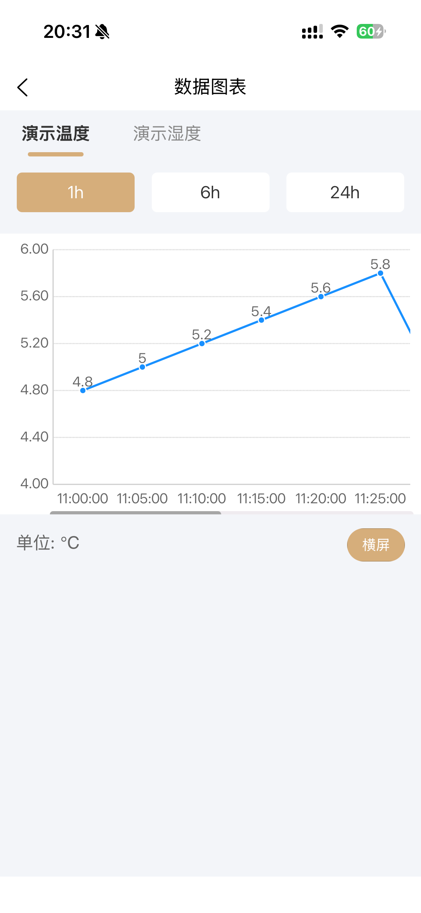
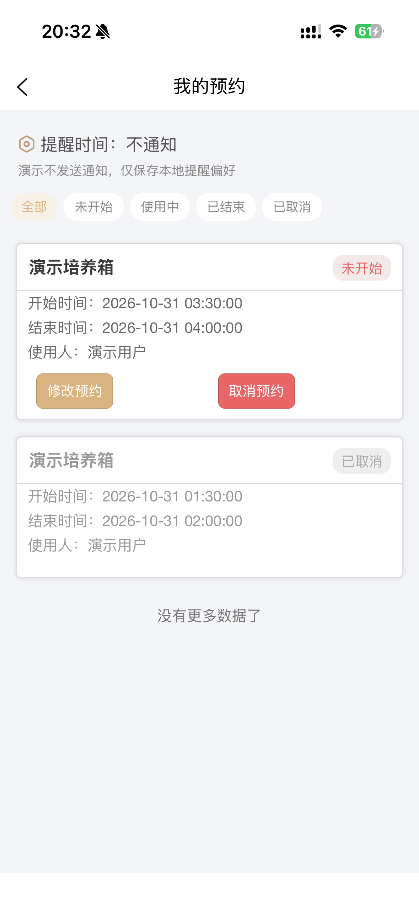

# 智慧设施助手小程序导览

基于 uni-app Vue 2、uni-ui 和 uCharts，展示设备查看、图表、预约与消息处理。本人从 0 搭建原小程序，负责首页、预约、数据图表、移液枪等部分模块，并有部署上线经验。当前在原工程上通过 AI 协作完成脱敏、Mock 化和多端适配，复用业务逻辑与公共组件，解决已有工程中的跨端问题。

优先阅读微信小程序业务链路，再看 H5、Android 独立 APK 与 iPhone 真机运行，最后按具体问题定位实现。

## 先看这条链路

**首页 → 设备列表 → 设备详情 → 数据图表 → 预约申请 → 我的预约**

| 步骤 | 看什么 | 对应代码 |
| --- | --- | --- |
| 首页进入设备 | 统计卡筛选、状态与读数 | [首页](../miniprogram/pages/tabBar/Home/Home.vue) → [设备入口](../miniprogram/pages/tabBar/Labdevice/index.vue) → [详情组件](../miniprogram/detailPage/LabdeviceDetail/LabdeviceDetail.vue) |
| 查看历史图表 | 温湿度曲线、时间跨度切换 | [图表页面](../miniprogram/detailPage/HistoryDataChart/HistoryDataChart.vue) |
| 创建并管理预约 | 选时、冲突校验、刷新回填与取消 | [选时组件](../miniprogram/components/AppointmentTime/index.vue) → [预约规则](../miniprogram/utils/demo/reservation.js) → [我的预约](../miniprogram/myPage/MyAppointment/MyAppointment.vue) |
| 按提问补充 | 消息已读、移液枪模拟取还、运单流转 | [消息中心](../miniprogram/homePage/NewsInform/NewsInform.vue) · [移液枪](pipette-gun.md) · [运单](transport.md) |

## 微信小程序

**首页**


**登录**


## 沿链路阅读实现

| 关注点 | 阅读入口 |
| --- | --- |
| 页面与接口分离 | [请求适配](../miniprogram/utils/request.js) → [Mock 入口](../miniprogram/utils/demo/index.js) → [业务规则](../miniprogram/utils/demo/reservation.js) |
| 登录和持久化 | [会话](../miniprogram/utils/demo/session.js) → [存储](../miniprogram/utils/demo/storage.js)，退出清理会话，保留本地业务记录 |
| 返回刷新与跨端组件 | [设备页 onShow](../miniprogram/pages/tabBar/Labdevice/index.vue) → [列表组件](../miniprogram/pages/tabBar/Labdevice/Labdevice.vue)；[导航适配](../miniprogram/components/NavigationBar/index.vue) |
| 移液枪导航 | [详情组件](../miniprogram/detailPage/PipetteGunDetail/GunDetail.vue) → [Mock 规则](../miniprogram/utils/demo/gun.js) → [返回栈处理](../miniprogram/utils/gunNavigation.js) |

## 跨端问题与实现

| 问题 | 处理方式与验证结果 | 阅读入口 |
| --- | --- | --- |
| 启动时页面未就绪、登录校验重复跳转 | 页面就绪后统一校验会话，通过跳转标记避免重复导航，并按页面状态关闭 App 启动屏；验证登录与冷启动 | [App 会话守卫](../miniprogram/App.vue) → [生命周期接入](../miniprogram/main.js) → [请求入口](../miniprogram/utils/request.js) |
| 状态栏、安全区和自定义导航的跨端差异 | 区分平台能力，调整导航测量、TabBar、页面留白、卡片及弹窗布局，复用同一业务页面 | [导航组件](../miniprogram/components/NavigationBar/index.vue) → [TabBar](../miniprogram/components/tabBar/tabBar.vue) → [全局样式](../miniprogram/App.vue) |
| Android 系统返回直接离开业务页 | 拦截系统返回，优先关闭已打开的业务弹窗；无弹窗时恢复常规返回行为 | [返回钩子](../miniprogram/main.js) → [弹窗关闭策略](../miniprogram/utils/app-popup-back.js) |
| 独立 APK 历史曲线空白 | 为图表容器补充明确高度和尺寸，修复版实际显示曲线并完成时间跨度切换；H5 回归检查画布尺寸与曲线可见性 | [历史图表](../miniprogram/detailPage/HistoryDataChart/HistoryDataChart.vue) → [浏览器检查](../scripts/check-miniapp-h5.cjs) |
| 报警分类切换导致统计跟随列表变化 | 在业务范围内先计算统计，再对列表执行处理状态筛选和分页；验证分类切换与处理前后的数量 | [报警规则 scopedEvents / wrapPage](../miniprogram/utils/demo/alarm.js) → [报警回归](../scripts/check-mp5-demo.cjs) |

相关检查：[启动](../scripts/check-miniapp-startup.cjs) · [弹窗返回](../scripts/check-miniapp-popup-back.cjs) · [H5 核心流程](../scripts/check-miniapp-h5.cjs)。分端操作结果集中在下方验收记录。

## H5 跨端补充

复用小程序业务与 Mock，补充浏览器布局、导航和弹窗适配。

**首页**


**我的预约**


## Android 独立 APK

完成独立 APK 打包、签名检查及 MuMu Android 15 安装验证，跑通登录、导航、设备详情、曲线切换、预约、报警处理和运单发车、送达；确认脱离调试基座冷启动后，本地业务状态保留。包版本、实际操作和回归结果见 [APK 验收记录](android-apk-validation.md)。

补充 Android 真机展示：设备预约弹窗、报警分类统计、运单详情与操作记录。

**设备预约弹窗**



**报警记录与分类统计**



**运单详情与操作记录**



## iOS 真机落地

Windows 下完成免费签名基座安装与 HBuilderX 项目同步，在 iPhone 真机跑通登录、五个导航、历史曲线 1h / 24h 切换及预约创建、取消；断开 USB 后可继续操作，退出重进后取消记录保留。具体操作见 [iOS 真机记录](ios-device-validation.md)。

**首页**



**历史曲线**



**我的预约**



## 本地体验

安装 HBuilderX 及 uni-app Vue 2 编译插件，在仓库根目录执行：

```powershell
cd miniprogram
npm run build:h5
npm run preview:h5
```

打开 `http://127.0.0.1:8188`，账号 `demo` / `Demo1234`。微信小程序通过 HBuilderX 运行到微信开发者工具，步骤见[运行指南](demo-guide.md#微信小程序启动)。

## 验证范围

微信小程序保留原工程能力并完成目标编译，原工作中的小程序具有上线经验。H5 以源码及本地演示交付；Android 已完成 MuMu Android 15 核心流程回归，并补充真机业务页面展示；iOS 使用签名调试基座在 iPhone 真机运行，区别于独立 IPA 交付与 App Store 发布。

业务使用本地 Mock，各端数据独立；真实微信授权、推送、蓝牙、打印及枪架控制不在当前验收范围。分端验收和已知问题集中见 [H5 与跨端记录](cross-platform-validation.md)、[Android 记录](android-apk-validation.md)、[iOS 记录](ios-device-validation.md)。安装包、签名材料、私有配置与调试缓存留在源码交付范围之外。

需要深入时再看：[预约与告警](reservation-and-alarm.md) · [验证记录](cross-platform-validation.md) · [检查脚本](../scripts/README.md) · [完整项目导览](PROJECT_GUIDE.md)。
